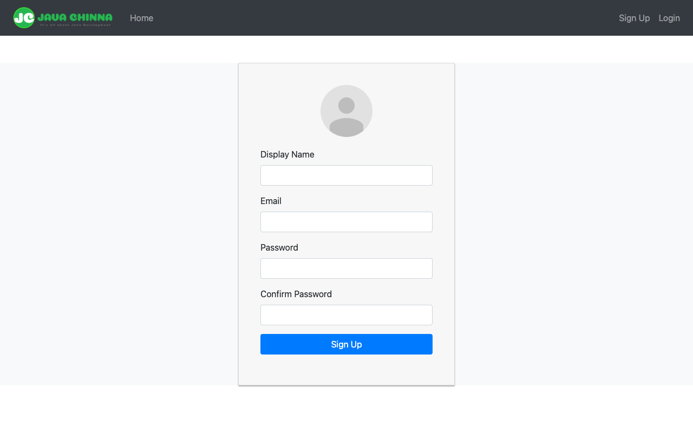
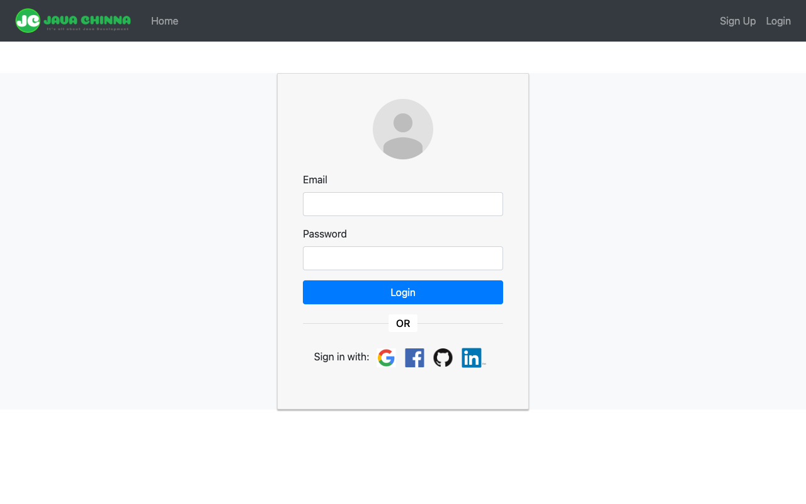
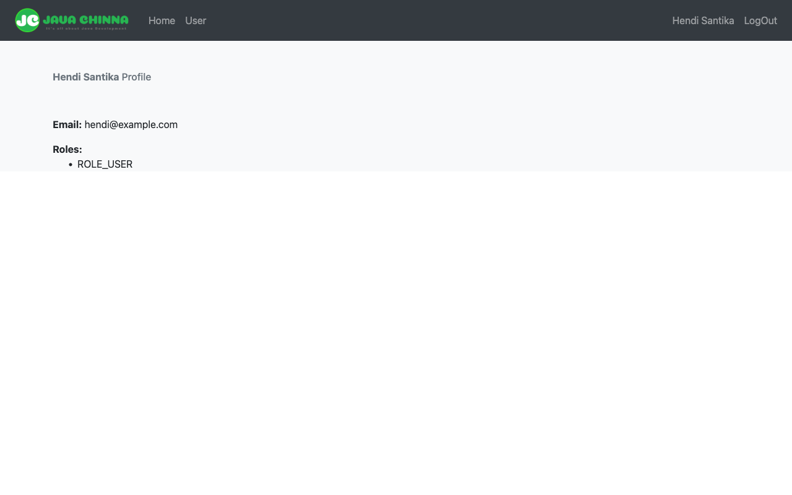

# Spring-Boot-Angular-10-User-Registration

[](https://github.com/hendisantika/Spring-Boot-Angular-10-User-Registration/actions/workflows/maven.yml)
[](https://github.com/hendisantika/Spring-Boot-Angular-10-User-Registration/actions/workflows/frontend.yml)


Spring Boot + Angular 10 User Registration with JWT authentication and OAuth2 Social Login
(Google, Facebook, GitHub and LinkedIn).

## Screenshots

| Sign Up | Login | Profile |
|:-------:|:-----:|:-------:|
|  |  |  |

## Tech Stack

| Layer    | Technology                                                                                  |
|----------|---------------------------------------------------------------------------------------------|
| Backend  | Java 25, Spring Boot 4.1.x, Spring Security 7 (OAuth2 Client), Spring Data JPA, jjwt 0.13   |
| Database | MySQL 8 (runtime), H2 in-memory (tests)                                                     |
| Frontend | Angular 10                                                                                  |
| Build    | Maven Wrapper (Maven 3.9.x), npm                                                            |
| CI/CD    | GitHub Actions (backend on JDK 25, frontend on Node 20), Dependabot                         |

## Project Structure

```
.
├── backend/                  # Spring Boot REST API (user-service)
├── angular-10-social-login/  # Angular 10 frontend
├── docs/screenshots/         # README screenshots
└── .github/
    ├── workflows/maven.yml    # CI: build & test backend with JDK 25
    ├── workflows/frontend.yml # CI: build & test Angular frontend (Node 20)
    └── dependabot.yml         # Automated dependency updates
```

## Prerequisites

- JDK 25
- MySQL 8 running on `localhost:3306` (user `root` / password `root` by default)
- Node.js + npm (for the Angular frontend)

## Running the Backend

1. Configure OAuth2 credentials in `backend/src/main/resources/application.properties`
   (replace every `<your-client-id>` / `<your-client-secret>`):

   ```properties
   spring.security.oauth2.client.registration.google.clientId=<your-client-id>
   spring.security.oauth2.client.registration.google.clientSecret=<your-client-secret>
   # ... facebook, github, linkedin
   ```

   Use `http://localhost:8080/login/oauth2/code/{provider}` as the redirect URI in each provider console.

2. Set a JWT secret of **at least 32 characters** (256 bits) in `app.auth.tokenSecret`.

3. Run the application:

   ```bash
   cd backend
   ./mvnw spring-boot:run
   ```

   The database `users` is created automatically and the API is available at `http://localhost:8080`.

### Build & Test

```bash
cd backend
./mvnw clean verify
```

Tests use an in-memory H2 database (`test` profile), so no MySQL instance is needed.

## Running the Frontend

```bash
cd angular-10-social-login
npm install
npx ng serve --port 8081
```

Open `http://localhost:8081`. The frontend calls the backend at `http://localhost:8080/`
(see `src/app/common/app.constants.ts`).

> **Note:** Angular 10 uses webpack 4. On Node.js 17+ set `NODE_OPTIONS=--openssl-legacy-provider`
> before running `ng serve` / `ng build` / `ng test`.

### Build & Test

```bash
cd angular-10-social-login
export NODE_OPTIONS=--openssl-legacy-provider
npx ng build --prod
npx ng test --watch=false --browsers=ChromeHeadlessCI
```

## Continuous Integration

| Workflow | Trigger | Steps |
|----------|---------|-------|
| [Java CI with Maven](.github/workflows/maven.yml) | push / PR to `main` | JDK 25 → `./mvnw clean verify` → dependency graph submission |
| [Angular CI](.github/workflows/frontend.yml) | push / PR to `main` touching `angular-10-social-login/**` | Node 20 → `npm ci` → `ng build --prod` → `ng test` (Chrome Headless) → upload `dist` artifact |

## API Endpoints

| Method | Endpoint                                  | Description                                  | Auth         |
|--------|-------------------------------------------|----------------------------------------------|--------------|
| POST   | `/api/auth/signup`                        | Register a new local user                    | Public       |
| POST   | `/api/auth/signin`                        | Login with email & password, returns a JWT   | Public       |
| GET    | `/api/user/me`                            | Get the current user's info                  | Bearer token |
| GET    | `/oauth2/authorization/{provider}`        | Start social login (`google`, `facebook`, `github`, `linkedin`) | Public |

After a successful social login, the user is redirected to the `redirect_uri` (must be listed in
`app.oauth2.authorizedRedirectUris`) with the JWT as the `token` query parameter.

Example:

```bash
curl -X POST http://localhost:8080/api/auth/signup \
  -H "Content-Type: application/json" \
  -d '{"displayName":"Hendi","email":"hendi@example.com","password":"secret123","matchingPassword":"secret123","socialProvider":"LOCAL"}'

curl -X POST http://localhost:8080/api/auth/signin \
  -H "Content-Type: application/json" \
  -d '{"email":"hendi@example.com","password":"secret123"}'

curl http://localhost:8080/api/user/me -H "Authorization: Bearer <accessToken>"
```

## Dependency Updates

[Dependabot](.github/dependabot.yml) keeps dependencies up to date:

- **Maven** (`/backend`) — daily, grouped: Spring, jjwt, other minor/patch updates
- **npm** (`/angular-10-social-login`) — weekly, grouped minor/patch; all major bumps (and 0.x-minor bumps of
  `@angular-devkit/build-angular` / `zone.js`, TypeScript minors) are ignored because the Angular 10 toolchain is
  version-locked — upgrade manually with `ng update`
- **GitHub Actions** — weekly, grouped into a single PR

## Author

**Hendi Santika**

- Email: hendisantika@gmail.com
- Telegram: [@hendisantika34](https://t.me/hendisantika34)
- Link: [s.id/hendisantika](https://s.id/hendisantika)
